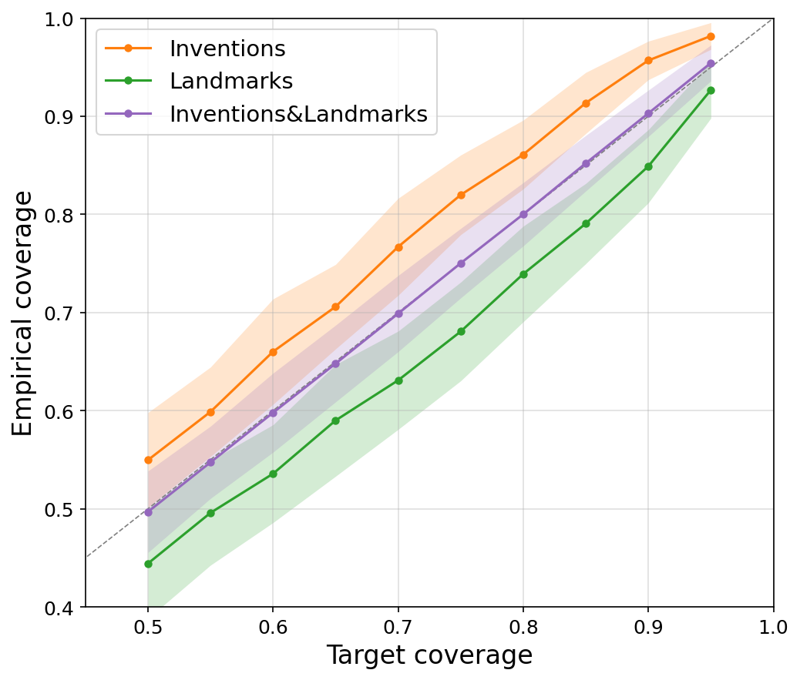
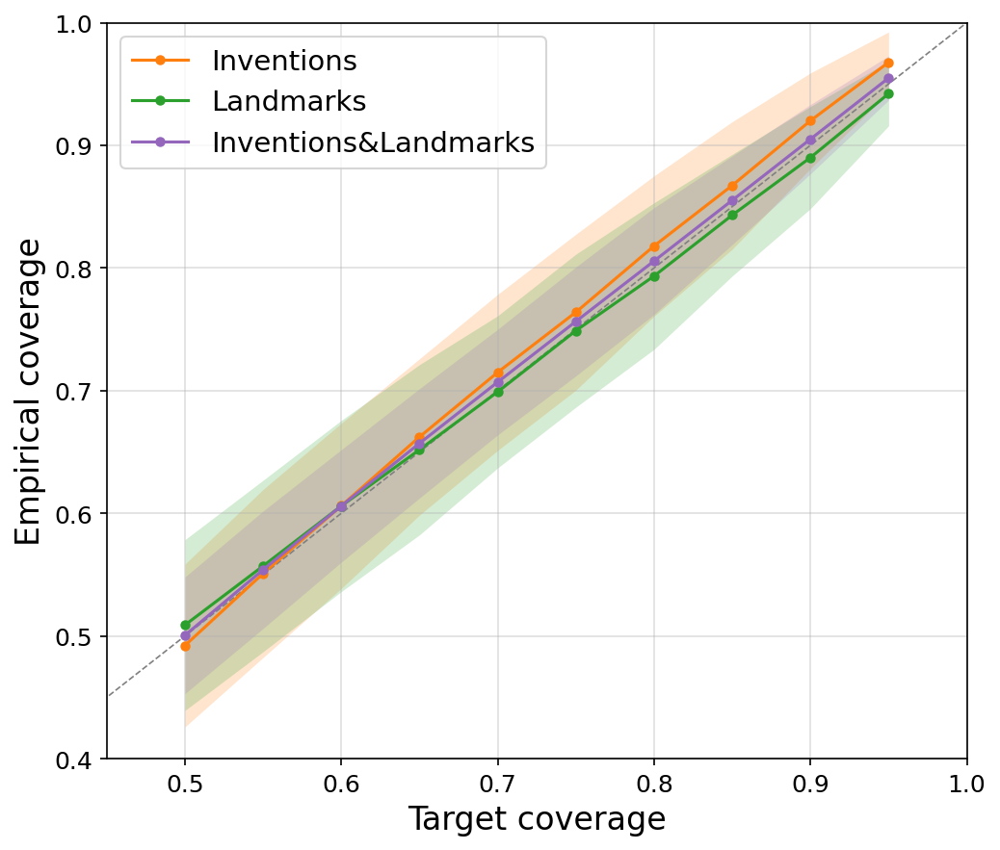

# Adaptive Conformal Prediction for Improving Factuality of Generations by Large Language Models

[Paper](https://arxiv.org/abs/2604.13991) · [Data](https://huggingface.co/datasets/arubashevskii/adaptive_conformal_factuality) · [BibTeX](#citation)

This repository contains the code to reproduce the experiments of the paper *Adaptive Conformal Prediction
for Improving Factuality of Generations by Large Language Models* (ACML 2026).

We filter uncertain claims out of LLM answers using a prompt-dependent conformal threshold learned by a
quantile regressor on prompt embeddings. This keeps the marginal factuality guarantee and improves per-topic
coverage without topic labels.

<p align="center">
  
  
</p>
<p align="center"><em>Coverage per category when calibrating on Inventions and Landmarks together:
global threshold (left) and adaptive (right).</em></p>

## Project structure

```
├── src/
│   ├── longform_data.py           # long-form data: one record per prompt with claims, labels, scores
│   ├── longform_conformal.py      # long-form methods: Original, Group-wise, Adaptive
│   ├── boosted.py                 # Boosted baseline (Cherian et al., 2024)
│   ├── mcqa_conformal.py          # multiple-choice QA methods: Original, Adaptive
│   ├── run_longform.py, run_boosted.py, run_mcqa.py   # experiments on many random splits
│   ├── make_*.py, plot_prompt_tsne.py, claim_score_prauc.py  # tables and figures
│   └── merge_mcqa_scores.py       # MCQA scores of one model -> one file
├── scripts/                       # reproduce_longform.sh, reproduce_mcqa.sh
├── data/                          # prompt and question embeddings; long_data/ is downloaded
├── mcqa/                          # MMLU prompting and answer probabilities (see mcqa/README.md)
├── results/                       # results of the paper, tables and figures
└── requirements.txt
```

## Setup

```bash
conda create -n adaptive-conformal python=3.12
conda activate adaptive-conformal
pip install -r requirements.txt
```

## Data

The long-form QA data are LM-Polygraph UE managers with the models' answers, atomic claims, GPT-4o
correctness labels and claim-level uncertainty scores for Mistral-7B-Instruct-v0.2, Llama-3.1-8B-Instruct
and Gemma-3-12B-Instruct (278 MB, see [data/README.md](data/README.md)):

```bash
hf download arubashevskii/adaptive_conformal_factuality --repo-type dataset \
    --include "ue_manager_*" --local-dir data/long_data
```

The MCQA answer probabilities (16 MMLU subjects) and all prompt embeddings are in the repository.

## Reproducing the paper

```bash
scripts/reproduce_longform.sh    # Tables 1-7 and Figure 1
scripts/reproduce_mcqa.sh        # Figures 2-4
python src/plot_prompt_tsne.py   # Figure 5
```

Each script also runs single steps, e.g. `scripts/reproduce_longform.sh main tables`; the steps are listed
at the top of the script.

| Paper | Step | Output |
|---|---|---|
| Table 1 | `reproduce_longform.sh table1` | `results/longform/table1.md` |
| Tables 2, 3, 5, 6 | `reproduce_longform.sh main boosted tables` | `results/longform/tables.md` |
| Table 4 | `reproduce_longform.sh ablation tables` | `results/longform/tables.md` |
| Table 7 | `reproduce_longform.sh highcov tables` | `results/longform/tables.md` |
| Figure 1 | `reproduce_longform.sh fig1 tables` | `results/longform/figures/fig1_*` |
| Figures 2, 3, 4 | `reproduce_mcqa.sh` | `results/mcqa/figures/` |
| Figure 5 | `python src/plot_prompt_tsne.py` | `results/longform/figures/fig5_tsne.pdf` |

The MCQA scores can be recomputed with the scripts in [mcqa/](mcqa/README.md), and the embeddings with
`src/make_prompt_embeddings.py` and `src/make_mcqa_embeddings.py`.

## Citation

```bibtex
@article{rubashevskii2026adaptive,
  title   = {Adaptive Conformal Prediction for Improving Factuality of Generations by Large Language Models},
  author  = {Rubashevskii, Aleksandr and Piatrashyn, Dzianis and Nakov, Preslav and Panov, Maxim},
  journal = {arXiv preprint arXiv:2604.13991},
  year    = {2026}
}
```

## License

MIT, see [LICENSE](LICENSE). The MMLU prompting code in `mcqa/` comes from
[ConformalLLM](https://github.com/bhaweshiitk/ConformalLLM) (MIT).
